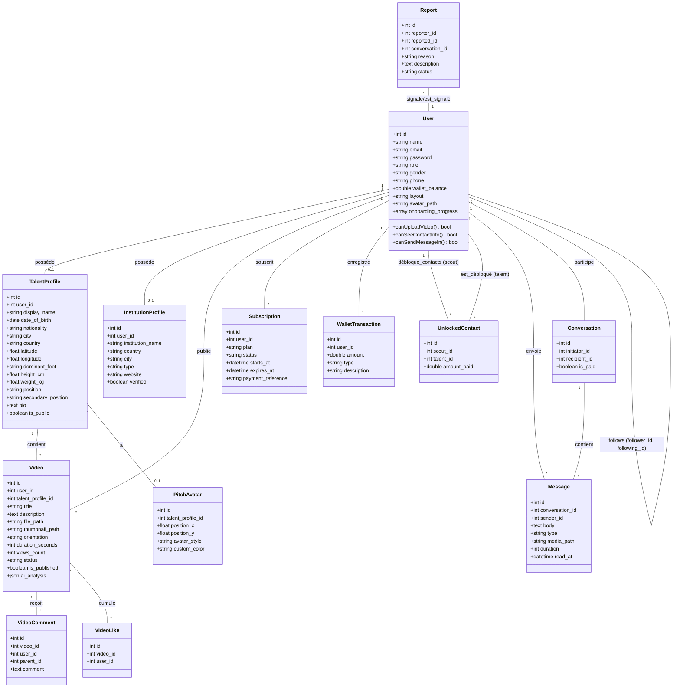
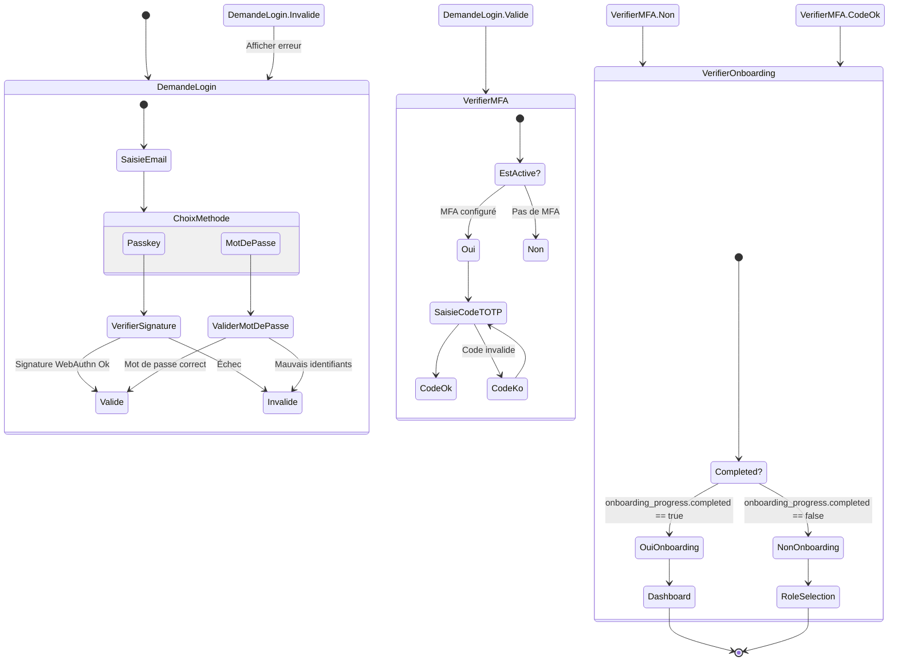
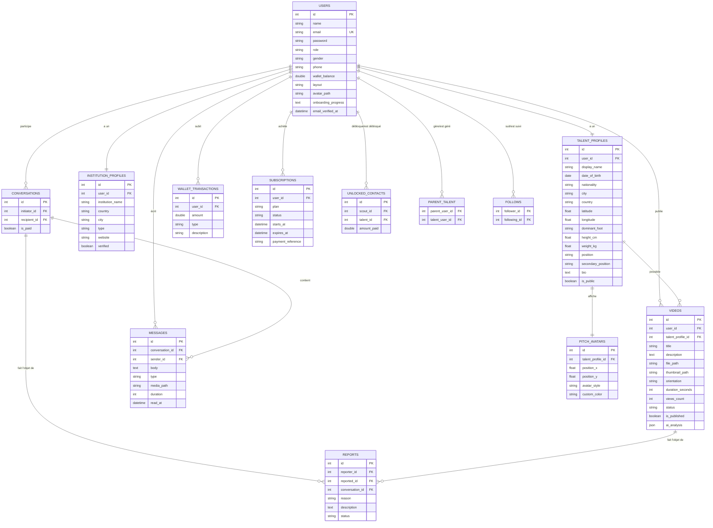

# Rapport de Projet de Fin d'Études : EndoTalent

---

## 1. Informations Générales & Identification du Projet
*   **Intitulé du Projet :** EndoTalent — Plateforme d'évaluation et de mise en relation des talents de football et des recruteurs (Scouts/Clubs)
*   **Niveau d'Études :** Soutenance de fin de formation (Diplôme BAC+2)
*   **Établissement :** Cité des Métiers et des Compétences (CMC) — Office de la Formation Professionnelle et de la Promotion du Travail (OFPPT)
*   **Développeurs / Candidats :**
    *   Saad Korma
    *   Oumaima Rouizate

---

## 2. Introduction, Contexte et Objectifs
Le recrutement dans le football moderne souffre de plusieurs limites, notamment la difficulté pour les recruteurs (scouts, clubs, agents) d'avoir accès à des vidéos de démonstration authentiques et de qualité de joueurs évoluant dans des divisions inférieures ou des académies isolées. De leur côté, les jeunes joueurs ou leurs parents manquent de canaux directs et sécurisés pour entrer en contact avec des clubs professionnels.

**EndoTalent** répond à cette problématique en proposant une plateforme web premium qui numérise et structure la détection des talents.

### Objectifs Clés :
*   Offrir une interface interactive de type TikTok pour la publication et le visionnage de vidéos de démonstration technique.
*   Permettre aux parents de gérer la carrière en ligne de leurs enfants mineurs par le biais de comptes liés.
*   Assurer un modèle économique de micro-transactions vertueux : les scouts payent pour débloquer les contacts ($50.00) ou engager des conversations ($10.00), et 90% des revenus sont reversés directement aux joueurs/parents.
*   Fournir des outils de communication temps réel avancés : messagerie instantanée (Laravel Reverb), notes vocales et appels audio/vidéo directs (WebRTC).
*   Garantir une sécurité robuste grâce à l'authentification double facteur (2FA) et aux clés de sécurité matérielles (Passkeys).
*   Intégrer l'intelligence artificielle générative (Google Gemini 2.5 Flash) pour fournir des analyses de scouting vidéo objectives, des statistiques physiques/techniques détaillées et des recommandations sur-mesure.
*   Proposer un assistant intelligent conversationnel ("Scout IA") pour accompagner les recruteurs dans la recherche de talents par critères en langage naturel.
*   Intégrer le suivi postural en temps réel (MediaPipe Pose Landmarker) pour permettre aux recruteurs d'analyser la biomécanique des joueurs directement sur le lecteur vidéo.
*   Fournir des outils d'évaluation comparative (Radar Charts d'attributs) et un classement national dynamique (Golden Boy Leaderboard) des meilleurs talents de la plateforme.

---

## 3. Architecture Technique et Choix Technologiques
L'application s'appuie sur une pile technologique moderne (Stack) garantissant performance, maintenabilité et sécurité :

```
+--------------------------------------------------------------------------------------+
|                                      FRONT-END                                       |
|   React 19 (SPA) + Inertia.js v3 (Protocol) + Tailwind CSS v4 (Design)               |
|   Animations: Framer Motion | Icons: Lucide React | MediaPipe Pose Tracking (GPU)    |
+--------------------------------------------------------------------------------------+
                                           |
                                           v (Inertia.js Protocol)
+--------------------------------------------------------------------------------------+
|                                      BACK-END                                        |
|   Laravel 13 (PHP 8.5) + Laravel Fortify (Authentification & Sécurité)              |
|   Laravel Reverb (WebSockets) + Laravel Wayfinder (Typed Routes)                     |
+--------------------------------------------------------------------------------------+
                               /     |     \      \
                              /      |      \      \
                             v       v       v      v
                     [SQLite]    [FFmpeg]   [WebRTC] [Google Gemini 2.5 Flash]
                     Database   Transcoding   Calls          AI API
```

### Détail des Composants Techniques :
1.  **Laravel 13 & PHP 8.5 :** Utilisation des dernières fonctionnalités de PHP (promotion de propriétés de constructeur, typage strict, déclarations de retour explicites) et de la structure simplifiée de Laravel 13.
2.  **Inertia.js v3 & React 19 :** Remplacement des API REST classiques par un protocole permettant de retourner des réponses d'interface (Inertia::render) directement depuis les contrôleurs Laravel, tout en bénéficiant de la rapidité d'une Single Page Application (SPA). React 19 intègre le nouveau React Compiler pour une réactivité optimale.
3.  **Tailwind CSS v4 :** Utilisation du nouveau moteur de rendu ultra-rapide basé sur Rust, avec définition de variables de thème OKLCH et gestion automatisée du mode sombre (`.dark`).
4.  **Laravel Fortify (Sécurité) :** Gestion de l'authentification au niveau serveur :
    *   *MFA (2FA)* : Double authentification par application d'authentification (Google Authenticator) générant un QR Code SVG et des codes de récupération.
    *   *Passkeys (WebAuthn)* : Enregistrement de clés biométriques (Windows Hello, FaceID, capteurs d'empreintes) pour un login sans mot de passe.
5.  **Laravel Reverb (WebSockets) :** Serveur WebSocket natif en PHP gérant la diffusion d'événements en temps réel (MessageSent, CallStarted, CallSignal) sur des canaux privés sécurisés.
6.  **FFmpeg (Traitement Vidéo) :** Intégration via `pbmedia/laravel-ffmpeg` pour décoder les vidéos uploadées, déterminer leur orientation, extraire automatiquement une miniature (thumbnail) à la première seconde, et les transcoder en format x264 léger hébergé sur AWS S3.
7.  **WebRTC (Appels Directs) :** Transmission de données de signalisation (SDP Offer/Answer et ICE Candidates) via WebSockets pour établir une connexion Peer-to-Peer directe entre le recruteur et le talent.
8.  **Google Gemini 2.5 Flash API :** Service d'intelligence artificielle intégré au backend via des requêtes HTTP asynchrones. Gemini est utilisé pour analyser les frames de vidéos (Vision) afin de générer des scores de performance et des rapports textuels, mais aussi comme moteur conversationnel pour le copilote des recruteurs (Scout IA).
9.  **MediaPipe Pose Landmarker :** Modèle de vision par ordinateur de Google exécuté côté client via WebAssembly et accéléré par GPU. Il permet d'extraire la posture corporelle et d'afficher un squelette en temps réel en superposition sur les vidéos de démo technique.

---

## 4. Diagrammes UML

### 4.1. Diagramme de Cas d'Utilisation (Use Case Diagram)
Ce diagramme montre les interactions entre les utilisateurs (Talent, Parent, Scout, Admin) et l'application.

```mermaid
useCaseDiagram
    rect border-color: #3b82f6; fill: #1e1e2e; text-color: #ffffff;
    
    actor Talent as "Joueur (Talent)"
    actor Parent as "Parent"
    actor Scout as "Recruteur (Scout/Club)"
    actor Admin as "Administrateur"
    
    Talent --> (S'inscrire et se connecter)
    Talent --> (Compléter son profil sportif)
    Talent --> (Uploader des vidéos de démo - Max 5 en gratuit)
    Talent --> (Abonner au Pack Pro pour vidéos illimitées)
    Talent --> (Consulter son portefeuille & transactions)
    Talent --> (Discuter avec les recruteurs débloqués)
    
    Parent --> (Créer des profils Enfants/Talents)
    Parent --> (Uploader des vidéos pour ses enfants)
    Parent --> (Gérer le portefeuille commun)
    
    Scout --> (Filtrer & Rechercher des Talents)
    Scout --> (Alimenter son portefeuille - Topup)
    Scout --> (Payer 50$ pour débloquer contact d'un joueur)
    Scout --> (Payer 10$ pour débloquer discussion avec un joueur)
    Scout --> (Envoyer messages, notes vocales et appeler en WebRTC)
    Scout --> (S'abonner pour accès illimité sans payer par action)
    
    Admin --> (Accéder au tableau de bord d'administration)
    Admin --> (Gérer les utilisateurs - Suppression)
    Admin --> (Ajuster les soldes des portefeuilles)
    Admin --> (Attribuer un bonus de 10% sur le solde)
    Admin --> (Consulter et résoudre les signalements de comportements)
```

---

### 4.2. Diagramme de Classes (Class Diagram)
Ce diagramme présente l'architecture orientée objet de nos modèles Eloquent et leurs relations logiques.



---

### 4.3. Diagramme de Séquence : Déblocage de Coordonnées (Contact Unlock)
Ce diagramme détaille la cinématique financière complexe du déblocage des coordonnées d'un joueur par un recruteur.

```mermaid
sequenceDiagram
    autonumber
    actor Scout as Recruteur (Scout)
    participant Système as Plateforme EndoTalent
    database DB as Base de Données
    actor Talent as Joueur (Talent/Parent)
    
    Note over Scout, Système: Le recruteur souhaite débloquer le contact d'un joueur
    Scout->>Système: Demande de déblocage (talent_id)
    Système->>DB: Vérifier le solde du portefeuille du Scout (Prix = 50.00$)
    alt Solde Insuffisant (Solde < 50.00$)
        DB-->>Système: Solde insuffisant
        Système-->>Scout: Erreur : Solde insuffisant, veuillez recharger
    else Solde Suffisant (Solde >= 50.00$)
        DB-->>Système: Solde suffisant
        Note over Système, DB: Lancement de la Transaction de Déblocage
        Système->>DB: Débiter 50.00$ du portefeuille du Scout
        Système->>DB: Calculer la part joueur (90% = 45.00$)
        Système->>DB: Créditer 45.00$ sur le portefeuille du Talent/Parent
        Système->>DB: Créer une WalletTransaction (Scout: -50$, Type: purchase_contact)
        Système->>DB: Créer une WalletTransaction (Talent: +45$, Type: received_contact)
        Système->>DB: Créer un enregistrement UnlockedContact (scout_id, talent_id)
        DB-->>Système: Transaction validée avec succès
        Système-->>Scout: Succès ! Coordonnées débloquées
        Système->>Talent: Notification : "Un recruteur a débloqué votre contact (+45.00$)"
    end
```

---

### 4.4. Diagramme de Séquence : Inscription Parent et Ajout de Profils Enfants
Ce diagramme présente comment un parent s'enregistre et ajoute des profils de joueurs mineurs sous sa responsabilité financière et légale.

```mermaid
sequenceDiagram
    autonumber
    actor Parent as Utilisateur (Parent)
    participant Ctrl as OnboardingController
    database DB as Base de Données
    
    Parent->>Ctrl: Choix du rôle "parent" (selectRole)
    Ctrl->>DB: Mettre à jour le rôle de l'utilisateur
    Ctrl-->>Parent: Redirection vers le formulaire TalentDetails
    Parent->>Ctrl: Saisir les infos du premier enfant (saveTalentDetails)
    Note over Ctrl, DB: Création automatique d'un compte Enfant factice
    Ctrl->>DB: Créer User (role: talent, email: talent-xxx@endotalent.com)
    Ctrl->>DB: Créer TalentProfile (hauteur, poids, poste, bio...)
    Ctrl->>DB: Insérer dans parent_talent (parent_user_id, talent_user_id)
    DB-->>Ctrl: Profils enregistrés
    Ctrl-->>Parent: Redirection vers le Dashboard
    
    Note over Parent, Ctrl: Ajout ultérieur d'enfants additionnels
    Parent->>Ctrl: Soumettre liste d'enfants (createChildTalent)
    loop Pour chaque enfant
        Ctrl->>DB: Créer User (role: talent) + TalentProfile
        Ctrl->>DB: Associer au Parent (parent_talent)
    end
    Ctrl-->>Parent: Retour avec notification flash toast
```

---

### 4.5. Diagramme d'Activité : Authentification et Vérification de Sécurité
Ce diagramme détaille le flux d'authentification sécurisé de l'utilisateur (Passkey, Mot de passe + MFA, redirection onboarding).



---

### 4.6. Diagramme d'Entité-Association (ERD)
Ce diagramme montre le modèle physique de données avec types de données et cardinalités.



---

## 5. Dictionnaire des Données Détaillé
Voici la structure précise des tables en base de données SQLite :

### Table `users`
*   `id` : INTEGER, Clé primaire, Auto-incrémenté.
*   `name` : VARCHAR(255), Nom complet de l'utilisateur.
*   `email` : VARCHAR(255), Unique, Clé d'identification.
*   `email_verified_at` : DATETIME, Nullable, Date de validation de l'adresse email.
*   `password` : VARCHAR(255), Mot de passe crypté (Hachage Bcrypt/Argon2).
*   `remember_token` : VARCHAR(100), Nullable, Jeton de reconnexion automatique.
*   `role` : VARCHAR(50), Rôle d'accès : 'talent', 'parent', 'scout_club', 'admin'.
*   `gender` : VARCHAR(20), Nullable, Sexe : 'male', 'female', 'other'.
*   `phone` : VARCHAR(50), Nullable, Téléphone.
*   `wallet_balance` : NUMERIC(10,2), Solde du portefeuille virtuel (Par défaut : 0.00).
*   `layout` : VARCHAR(50), Nullable, Préférences d'affichage visuel.
*   `avatar_path` : VARCHAR(255), Nullable, Lien vers l'image de profil.
*   `onboarding_progress` : TEXT (Cast JSON array), Nullable, Suivi des étapes d'inscription.
*   `two_factor_secret` : TEXT, Nullable, Clé de chiffrement MFA.
*   `two_factor_recovery_codes` : TEXT, Nullable, Codes d'urgence MFA.
*   `two_factor_confirmed_at` : DATETIME, Nullable, Date d'activation de la MFA.

### Table `talent_profiles`
*   `id` : INTEGER, Clé primaire.
*   `user_id` : INTEGER, Clé étrangère liée à `users.id` (Suppression en cascade).
*   `display_name` : VARCHAR(255), Nom d'affichage public du joueur.
*   `date_of_birth` : DATE, Date de naissance pour la gestion d'âge.
*   `nationality` : VARCHAR(100), Nationalité du joueur.
*   `city` : VARCHAR(100), Nullable, Ville.
*   `country` : VARCHAR(100), Nullable, Pays.
*   `latitude` : FLOAT, Nullable, Coordonnée X pour la cartographie.
*   `longitude` : FLOAT, Nullable, Coordonnée Y pour la cartographie.
*   `dominant_foot` : VARCHAR(20), Pied de tir : 'left', 'right', 'both'.
*   `height_cm` : FLOAT, Taille en centimètres (ex: 175.5).
*   `weight_kg` : FLOAT, Poids en kilogrammes (ex: 68.0).
*   `position` : VARCHAR(10), Poste principal (ex: ST, CB, GK).
*   `secondary_position` : VARCHAR(10), Nullable, Poste secondaire.
*   `bio` : TEXT, Nullable, Biographie sportive.
*   `is_public` : TINYINT(1), Visibilité de la fiche (1 = Public, 0 = Privé).

### Table `institution_profiles`
*   `id` : INTEGER, Clé primaire.
*   `user_id` : INTEGER, Clé étrangère liée à `users.id`.
*   `institution_name` : VARCHAR(255), Nom de la structure (Club, Agence, École).
*   `country` : VARCHAR(100), Pays.
*   `city` : VARCHAR(100), Ville.
*   `type` : VARCHAR(50), Type d'entité : 'school', 'club', 'scout_agency', 'scout_club'.
*   `website` : VARCHAR(255), Nullable, Lien vers le site web officiel.
*   `verified` : TINYINT(1), Statut vérifié par les modérateurs (1 = Vérifié, 0 = Normal).

### Table `videos`
*   `id` : INTEGER, Clé primaire.
*   `user_id` : INTEGER, Clé étrangère (auteur de la vidéo).
*   `talent_profile_id` : INTEGER, Clé étrangère (joueur concerné).
*   `title` : VARCHAR(255), Titre de la vidéo.
*   `description` : TEXT, Nullable, Description de l'action.
*   `file_path` : VARCHAR(255), Chemin d'accès au fichier vidéo.
*   `thumbnail_path` : VARCHAR(255), Nullable, Lien vers la capture d'image.
*   `orientation` : VARCHAR(50), 'vertical' (format TikTok) ou 'cinema'.
*   `duration_seconds` : INTEGER, Durée du clip en secondes.
*   `views_count` : INTEGER, Nombre de visionnages.
*   `status` : VARCHAR(50), État de la conversion FFMpeg ('ready', 'processing', 'failed').
*   `is_published` : TINYINT(1), Statut de diffusion.
*   `ai_analysis` : TEXT (Cast JSON), Nullable, Contient le rapport d'analyse technique et de scouting généré par l'IA (score global, notes physiques/techniques/tactiques, forces, faiblesses, recommandations et joueur professionnel comparable).

### Table `conversations`
*   `id` : INTEGER, Clé primaire.
*   `initiator_id` : INTEGER, Clé étrangère (créateur de la conversation).
*   `recipient_id` : INTEGER, Clé étrangère (destinataire).
*   `is_paid` : TINYINT(1), Indique si les frais d'accès aux messages ont été réglés par le scout (1 = Débloqué, 0 = Bloqué).

### Table `messages`
*   `id` : INTEGER, Clé primaire.
*   `conversation_id` : INTEGER, Clé étrangère de liaison.
*   `sender_id` : INTEGER, Auteur du message.
*   `body` : TEXT, Corps du message texte.
*   `type` : VARCHAR(50), Format : 'text', 'voice', 'media'.
*   `media_path` : VARCHAR(255), Nullable, Lien du fichier audio ou image.
*   `duration` : INTEGER, Nullable, Durée du message vocal.
*   `read_at` : DATETIME, Nullable, Date de lecture du message par le destinataire.

### Table `wallet_transactions`
*   `id` : INTEGER, Clé primaire.
*   `user_id` : INTEGER, Clé étrangère du propriétaire du portefeuille.
*   `amount` : NUMERIC(10,2), Montant (Négatif pour les débits, positif pour les crédits).
*   `type` : VARCHAR(50), Nature du flux (ex: 'topup', 'purchase_contact', 'received_contact', 'buy_pro', 'bonus').
*   `description` : VARCHAR(255), Nullable, Libellé de la transaction.

---

## 6. Routage de l'Application et Contrôleurs

Le système de routes de Laravel est organisé en plusieurs blocs protégés par des middlewares :

```
             +-----------------------+
             |      ROUTE GET /      |
             +-----------------------+
                         |
           +-------------+-------------+
           | Authentifié?              |
          Non                         Oui
           |                           |
           v                           v
   [Inertia: welcome]          [Redirection /videos]
                                       |
                             +---------+---------+
                             |  Middleware Auth  |
                             +---------+---------+
                                       |
                 +---------------------+---------------------+
                 |                                           |
                 v                                           v
       [Routes de Base]                             [Routes Spécifiques]
       - Dashboard (/dashboard)                     - Scout: Talents Directory (/talents)
       - Chat Room (/chat)                          - Admin: Control Panel (/admin)
       - Wallet Page (/wallet)                      - Settings: Profile/Security (/settings)
       - Call Actions (/call)                       - AI Copilot API (/api/copilot)
       - Leaderboard (/leaderboard)                 - Compare Talents (/talents/compare)
       - Profil Direct (/talents/profil)            - CV Download (/talents/{id}/cv)
```

### 6.1. Contrôleurs et Actions Détaillés :

#### `OnboardingController`
*   `showRoleSelection()` : Affiche le choix de profil (Talent, Parent, Scout).
*   `selectRole(Request)` : Enregistre le rôle de l'utilisateur.
*   `showTalentDetails()` : Renvoie le formulaire d'inscription sportive.
*   `saveTalentDetails(Request)` : Gère l'insertion en base. Si le rôle est "parent", il génère automatiquement un compte joueur lié à l'adresse e-mail `@endotalent.com` et l'associe dans la table pivot `parent_talent`.
*   `createChildTalent(Request)` : Permet à un utilisateur parent d'ajouter de nouveaux profils d'enfants à la demande depuis son dashboard.

#### `TalentController`
*   `index(Request)` : Moteur de recherche des joueurs. Permet de filtrer par poste, pied dominant, pays, sexe, mot-clé textuel et score IA minimum.
*   `show(TalentProfile)` : Renvoie la fiche technique du joueur et détermine si le recruteur a le droit d'afficher les contacts.
*   `unlockContact(Request, TalentProfile)` : Déclenche l'achat des coordonnées. Débite 50$ du compte Scout, crédite 90% (45$) sur le compte du joueur (ou du parent), génère les transactions et crée l'enregistrement `UnlockedContact`.
*   `leaderboard()` : Calcule et renvoie la liste des meilleurs joueurs (Golden Boy Leaderboard) classés selon la moyenne de leurs scores d'évaluation IA.
*   `compare(Request)` : Affiche l'outil de comparaison comparative entre deux joueurs, visualisant leurs attributs respectifs (Physique, Technique, Tactique, Mental, Vitesse) sur un graphique en radar.
*   `downloadCv(TalentProfile)` : Rendre une vue HTML propre et stylisée (`cv.blade.php`) représentant le CV sportif professionnel du joueur et déclenche son téléchargement direct pour les recruteurs autorisés.

#### `ChatController`
*   `index()` : Récupère les salons de discussion de l'utilisateur, compte les messages non lus et vérifie le statut de payement.
*   `show(Conversation)` : Charge les messages du fil de discussion.
*   `store(Request, Conversation)` : Enregistre un message texte et déclenche l'événement WebSocket `MessageSent` pour une transmission instantanée.
*   `pay(Conversation)` : Gère le déblocage de discussion. Coûte 10$, distribue 90% de gains au joueur/parent, et passe `is_paid` à 1.
*   `voice(Request, Conversation)` : Enregistre une note vocale au format audio WebM/WAV, la place dans le stockage public, et crée le message correspondant.

#### `CallController`
*   `start(Request, Conversation)` : Lance une session d'appel vidéo ou audio. Valide les droits d'accès et transmet l'événement `CallStarted` aux autres membres de la conversation.
*   `signal(Request, Conversation)` : Canalise et transmet les métadonnées WebRTC d'offres/réponses SDP et d'ICE candidates entre les navigateurs connectés.

#### `VideoController`
*   `index()` : Affiche le flux des vidéos sous forme de flux TikTok infini. Calcule dynamiquement si l'utilisateur connecté aime (like) la vidéo ou suit (follow) le créateur.
*   `store(Request)` : Gère l'upload de clips vidéo. Vérifie la limite de 5 vidéos si le compte est gratuit. Associe le fichier au bon profil de joueur (ou à l'enfant sélectionné si c'est un parent qui poste) puis dispatch le job en file d'attente.
*   `destroy(Video)` : Supprime définitivement une vidéo et son fichier physique associé.

#### `WalletController`
*   `index()` : Présente le tableau des flux financiers personnels.
*   `topup(Request)` : Simule un payement par carte bancaire pour augmenter le solde de crédit.
*   `transfer(Request)` : Permet à un scout de transférer directement des fonds vers un joueur ou un parent (Fonctionnalité interdite aux rôles talents et parents).

#### `AdminController`
*   `dashboard()` : Tableau de bord de statistiques affichant la liste des comptes, l'historique global des transactions et les signalements d'utilisateurs.
*   `deleteUser(User)` : Supprime définitivement un profil utilisateur.
*   `updateWallet(Request, User)` : Ajuste le solde d'un portefeuille (Débit ou crédit) ou applique automatiquement un **bonus exceptionnel de 10%** sur le solde de l'utilisateur ciblé.

#### `CopilotController`
*   `ask(Request)` : Endpoint de l'assistant de recrutement intelligent "Scout IA". Il reçoit les prompts du recruteur, interroge l'API Gemini 2.5 Flash, applique des règles métier (respect de la barrière Premium pour les profils non débloqués) et extrait de manière structurée d'éventuels filtres de recherche (poste, pied, score IA minimum) pour retourner des suggestions de joueurs ciblées directement au sein du chat.

---

## 7. Traitement Asynchrone des Vidéos (FFmpeg et IA)
L'importation de vidéos lourdes sur le web nécessite un traitement adapté. Lorsqu'un utilisateur publie une vidéo, l'application utilise une file d'attente (Queue Listener) pour exécuter la tâche **`ProcessVideoJob`** en arrière-plan :

```
                       [ Vidéo Uploadée (Max 100 Mo) ]
                                      |
                                      v
                       [ Job: ProcessVideoJob Dispatché ]
                                      |
                                      v
                      [ Changement de statut: 'processing' ]
                                      |
                                      v
                +---------------------+---------------------+
                |                                           |
                v                                           v
       [ Détection Orientation ]                    [ Transcodage H.264 ]
     - Analyse Largeur vs Hauteur                 - Compression vidéo/audio
     - Définit 'vertical' / 'cinema'              - Bitrate réglé à 1000 Kbps
                |                                           |
                +---------------------+---------------------+
                                      |
                                      v
         +----------------------------+----------------------------+
         |                                                         |
         v                                                         v
  [ Vignette Classique ]                                  [ Extraction de Frames ]
- Capture d'une image à la 1s                         - Frames extraites à 25% et 60%
         |                                                         |
         |                                                         v
         |                                                [ Service d'IA Gemini ]
         |                                            - Analyse des frames (Vision)
         |                                            - Prompt structuré avec profil
         |                                            - Génération du rapport de scouting
         |                                                         |
         +----------------------------+----------------------------+
                                      |
                                      v
                    [ Upload des fichiers sur Amazon S3 ]
                                      |
                                      v
              [ Sauvegarde ai_analysis & Statut 'ready' ]
```

Cette architecture prévient la surcharge du serveur et assure aux utilisateurs mobiles un visionnage fluide sans latence. De plus, l'extraction de frames clés permet à notre intelligence artificielle d'obtenir des visuels de l'action à différents moments de la séquence afin de produire un rapport de scouting structuré et objectif dans le champ `ai_analysis`.

---

## 8. Authentification Avancée et Sécurité (Fortify & MFA)
La sécurité de notre application répond aux normes strictes de conformité informatique :
1.  **Double Facteur (2FA) :**
    *   Le serveur Laravel Fortify fournit des clés secrètes encodées en Base32.
    *   L'application convertit ces données en QR Code au format SVG. L'utilisateur le scanne via Google Authenticator ou Authy.
    *   L'accès au compte nécessite la saisie d'un jeton dynamique à 6 chiffres (One-Time Password) renouvelé toutes les 30 secondes.
    *   L'application génère des codes de secours (Recovery Codes) à usage unique, stockés de manière sécurisée et hachée en base de données.
2.  **Clés de Sécurité (Passkeys) :**
    *   Intégration du protocole WebAuthn qui utilise la cryptographie asymétrique.
    *   L'authentificateur local (ex: Windows Hello, puce TPM, TouchID) génère une paire de clés. Seule la clé publique est enregistrée sur notre serveur.
    *   La connexion se fait sans mot de passe, en validant la signature biométrique de l'utilisateur, ce qui élimine les risques de Phishing (Hameçonnage).

---

## 9. Intégration Visuelle et Expérience Utilisateur
L'interface de l'application a été conçue pour offrir un aspect dynamique, haut de gamme et immersif :
*   **Charte Graphique Moderne :** Utilisation de l'espace de couleurs OKLCH pour des dégradés de vert vibrants (`oklch(0.6 0.18 145)`) qui s'adaptent harmonieusement en mode sombre (`oklch(0.7 0.15 145)`) sur des fonds sombres de type anthracite et noir.
*   **Effets Glassmorphism :** Application de classes de flou d'arrière-plan (`backdrop-blur-md`) et de bordures semi-transparentes pour donner un aspect de verre dépoli aux panneaux de contrôle, au chat et aux fenêtres modales.
*   **Micro-animations Intégrées :** Transition en fondu des pages avec `AnimatePresence` de Framer Motion, effets de survol réactifs (`hover:scale-105`), menus déroulants coulissants, boutons à particules explosives et barres de chargement animées.
*   **Le concept Pitch-Avatar (Thème Inazuma Eleven) :**
    *   Pour rendre la plateforme ludique et unique, les profils des joueurs sans photo personnalisée se voient attribuer automatiquement un personnage de l'anime *Inazuma Eleven* selon le poste occupé :
        *   **Mamoru Endou (Gardien)** pour le poste `GK`.
        *   **Ichirouta Kazemaru (Défenseur)** pour les postes `CB`, `LB`, `RB`.
        *   **Yuuto Kidou (Milieu)** pour les postes `CDM`, `CM`, `CAM`, `AMF`, `CMD`.
        *   **Shuuya Gouenji (Attaquant)** pour les postes `LW`, `RW`, `ST`, `CF`.
    *   Ce composant est rendu de manière interactive sur le terrain virtuel (Scouting Pitch) où les recruteurs visualisent la position des joueurs directement sur un schéma de terrain de football réactif.

---

## 10. Tests Automatisés et Validation du Projet
Pour garantir la stabilité du code, nous avons mis en œuvre une suite de tests unitaires et d'intégration avec **Pest PHP** :
*   **Tests de Portefeuille (Wallet) :** Validation des rechargements, des transactions et interdiction pour les joueurs/parents de transférer de l'argent vers d'autres membres.
*   **Tests d'Achats (Unlocks) :** Simulation du parcours d'achat de contact (Désactivation des accès par défaut, contrôle de solde insuffisant, calcul du prélèvement des 50$, partage des 90% et déblocage final).
*   **Tests d'Onboarding complexes :** Simulation de l'enregistrement de rôles parents, vérification de la création automatique de profils enfants et de leur liaison dans les tables pivots.
*   **Tests de Sécurité d'Accès :** Validation des politiques d'accès (Policies) empêchant un compte de type joueur d'accéder à l'annuaire des talents ou aux fonctions administratives.

La totalité de notre suite de tests s'exécute avec succès en environnement isolé (`RefreshDatabase`), garantissant ainsi la qualité et l'absence de régressions dans le projet.

---

## 11. Fonctionnalités Avancées "Waouh" et Intelligence Artificielle

Afin de se démarquer et d'offrir une valeur ajoutée exceptionnelle pour l'obtention du diplôme BAC+2, nous avons intégré des fonctionnalités innovantes de pointe basées sur l'intelligence artificielle et la vision par ordinateur :

### 11.1. Analyse Vidéo par Vision Artificielle (Google Gemini 2.5 Flash Vision)
Lorsqu'une vidéo est traitée en arrière-plan par `ProcessVideoJob`, l'application extrait deux captures d'écran à des moments stratégiques de la vidéo (à 25% et 60% de sa durée). Ces images sont envoyées à l'API Google Gemini 2.5 Flash avec le profil détaillé du joueur (poste, pied fort, mensurations, biographie).
L'IA réalise une analyse technique et renvoie un rapport de scouting structuré au format JSON comprenant :
*   **Un score de performance global** (de 40 à 99).
*   **Des notes par secteur** : Physique, Technique, Tactique, Mental, Vitesse.
*   **Des forces et des faiblesses** synthétiques.
*   **Un joueur professionnel comparable** ayant un style de jeu similaire.
*   **Un résumé professionnel en français** et des conseils personnalisés pour la progression du joueur.

### 11.2. Scout IA — Le Copilote de Recrutement Conversationnel
Intégré sous forme d'un chatbot flottant global (`global-chatbot.tsx`), **Scout IA** est un assistant conversationnel intelligent propulsé par Gemini 2.5 Flash.
*   **Recherche par Langage Naturel** : Les recruteurs peuvent poser des questions comme *"Je cherche un attaquant rapide droitier avec un score IA d'au moins 80"*. L'IA analyse le message, en extrait des filtres structurés et renvoie instantanément des suggestions de profils interactives dans la fenêtre de discussion.
*   **Respect de l'aspect Premium** : Si le contact d'un joueur n'est pas débloqué (barrière payante de 50$), l'assistant refuse poliment de divulguer les statistiques avancées, les forces/faiblesses et l'analyse vidéo détaillée de ce joueur, préservant ainsi le modèle économique de la plateforme.

### 11.3. Suivi Postural en Temps Réel (MediaPipe Task Vision)
Nous avons intégré le modèle d'IA **Google MediaPipe Pose Landmarker** directement côté client via WebAssembly (accélération GPU).
*   Sur le lecteur vidéo de démo (`mediapipe-video-player.tsx`), le recruteur peut activer d'un simple clic le tracker de posture.
*   Un squelette vert émeraude fluorescent s'affiche en superposition sur le joueur en temps réel, traquant 33 repères corporels (articulations, membres, inclinaisons du corps).
*   Cela permet aux recruteurs d'évaluer scientifiquement les angles de course, les gestes techniques de tir, et les appuis physiques du joueur.

### 11.4. Outil de Comparaison Interactive de Talents (Compare Tool)
Accessible depuis `/talents/compare`, cet outil permet de mettre en opposition deux joueurs de la plateforme.
*   Il compare les attributs physiques et sportifs généraux.
*   Il génère dynamiquement un **graphique en radar (Radar Chart)** superposant les statistiques d'évaluation issues des analyses IA de chaque joueur, offrant une aide à la décision visuelle instantanée pour les clubs.

### 11.5. Golden Boy Leaderboard (Classement National)
Pour gamifier la plateforme et inciter les talents à soumettre leurs meilleures vidéos, le menu `/leaderboard` affiche le classement national des joueurs.
*   Un podium premium en 3D met en valeur le **Top 3** avec des trophées animés (Or, Argent, Bronze).
*   Une liste déroulante répertorie le reste des talents du classement.
*   Le classement est trié de manière dynamique selon le score d'évaluation IA moyen calculé sur l'ensemble de leurs vidéos publiées.

### 11.6. Génération de CV Sportif Professionnel PDF
Pour faciliter les partages et l'archivage, les recruteurs ayant débloqué un profil peuvent télécharger une fiche technique PDF (`cv.blade.php`) au format professionnel A4. Ce CV structuré contient la photo du joueur, ses coordonnées complètes, ses mensurations, son profil Inazuma Eleven et la synthèse de ses évaluations techniques IA.
